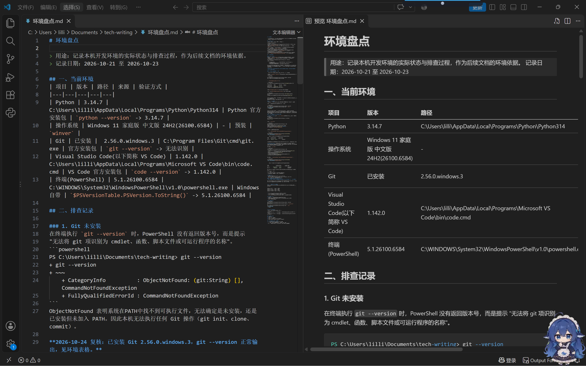

# Technical Writing 学习记录

> 记录我从零开始的 Technical Writing 学习记录，致所有的初学者。

## 这是个什么仓库？

这个仓库是用于学习 Technical Writing，目的是记录我的学习历程。

## 目录

| 文件 | 内容 |
|---|---|
| raw-log.md | 用于平时运行代码记录 |
| 环境盘点.md | 记录本机开发环境的实际状态与排查过程，作为后续文档的环境依据 |
| httpx项目调查.md | httpx 项目调查：安装验证、文档评审与三个待解问题 |
| glossary.md | 我自己的术语表 |
| images/ | 截图 |

## 当前进度

- 阶段 1（2026-10-19 至 2026-10-28）: 工具链与项目选择 —— 已完成
  - Markdown 六件套、Git 本地仓库与远程同步
  - 选定 httpx，完成项目调查记录
- 阶段 2（2026-11）: 第一份可验证的文档作品 —— 即将开始

## 环境

这是我的环境： [环境盘点](环境盘点.md)



## 怎么用

本仓库只有 Markdown 文件和图片，不需要安装依赖。想查看提交历史：

1. 打开 PowerShell 或终端
2. 切换到本仓库所在目录
3. 运行 `git log --oneline`

```powershell
PS C:\Users\lilli\Documents\tech-writing> git log --oneline
1af965e (HEAD -> main, origin/main) docs: 完成 httpx 项目调查记录
5434651 docs:记录阶段1进展
ebc876a docs: 补充代理配置的原始记录
27cdacc docs: 添加 README仓库
105116b docs: 添加环境盘点与排查记录
```


