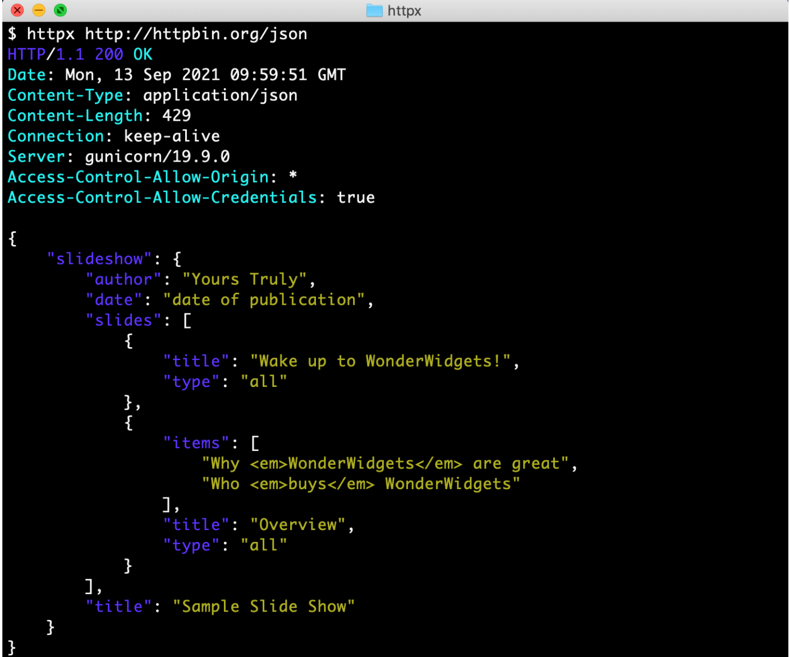
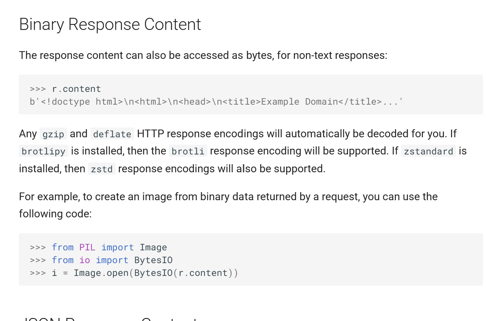

# httpx 项目调查

## 项目用途

HTTPX 是给 Python 程序员用的 HTTP 客户端库，它能帮助用户更加简单地获取完整响应——包括状态码、响应头和响应体。

## 目标读者

面向 Python 程序员（从 "for Python 3" 推断）。文档未声明前置知识要求。但从 Quickstart 直接使用 GET 请求、状态码和
Headers 而不作解释来看，它假设读者已了解 HTTP 基本概念。

## 验证记录

以下命令在 2026-10-26 实际执行，环境为 Windows 11 + Python 3.14.7。

```powershell
PS C:\Users\lilli\Documents\projects\httpx> python -m pip install httpx

Successfully installed anyio-4.15.1 certifi-2026.10.23 h11-0.16.0 httpcore-1.0.9 httpx-0.28.1 idna-3.20 typing_extensions-4.16.0
```

发送 GET 请求并查看状态码：

```powershell
PS C:\Users\lilli\Documents\tech-writing> python
Python 3.14.7 (tags/v3.14.7:823f032, Aug  5 2026, 10:51:32) [MSC v.1944 64 bit (AMD64)] on win32
Type "help", "copyright", "credits" or "license" for more information.
```

```pycon
>>> import httpx
>>> r = httpx.get('https://www.example.org/')
>>> r
<Response [200 OK]>
```

安装成功，且能正常发送请求。两次命令在不同目录执行，说明 httpx 安装后不依赖当前路径。

## 可改进的文档点
1. "HTTPX is a fully featured HTTP client library for Python 3. It includes an integrated command line client, has support for both HTTP/1.1 and HTTP/2, and provides both sync and async APIs."

这句话有很多术语并未给予解释，这可能使初学者感到困惑。

2. README 中的命令行演示截图显示响应时间为 2021-09-13，该截图至少四年未更新。但仓库最近一次提交为 2026-02-23，说明项目本身仍在积极维护，只是截图未同步更新。



3. Quickstart 没有显式声明目标读者和前置知识要求。读者可以从"for Python 3"推断出这是面向 Python 程序员，但是否需要了解 HTTP 协议、是否需要有网络编程经验，文档没有说明。对初学者而言，这种隐含假设很容易造成误判。

4. Introduction 页中，只回答了文档覆盖什么范围，并没有告诉我们文档不覆盖什么。

5. Quickstart 页有多处被动语态，比如以下两句可以改成主动，读起来更直接：

- The response content can also be accessed as bytes -> You can also access the response content as bytes
- Any gzip and deflate HTTP response encodings will automatically be decoded for you -> HTTPX automatically decodes gzip and deflate response encodings

注：并非所有被动句都需要改。当动作执行者不重要时（如"自动解码"），被动是可接受的。




## 我还不理解的问题

1. 为什么同一个网址，httpx 返回 200，urllib 却抛异常？

2. 为什么用这个 httpx 就能简化这么多步骤呢，它的原理是什么？

3. 官方 Quickstart 假设读者懂 HTTP，如果要写一版面向初学者的，应该先补哪些概念？